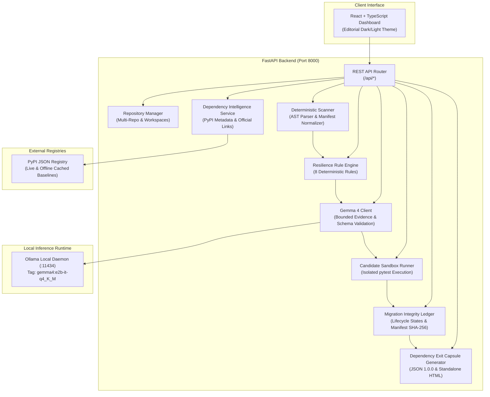
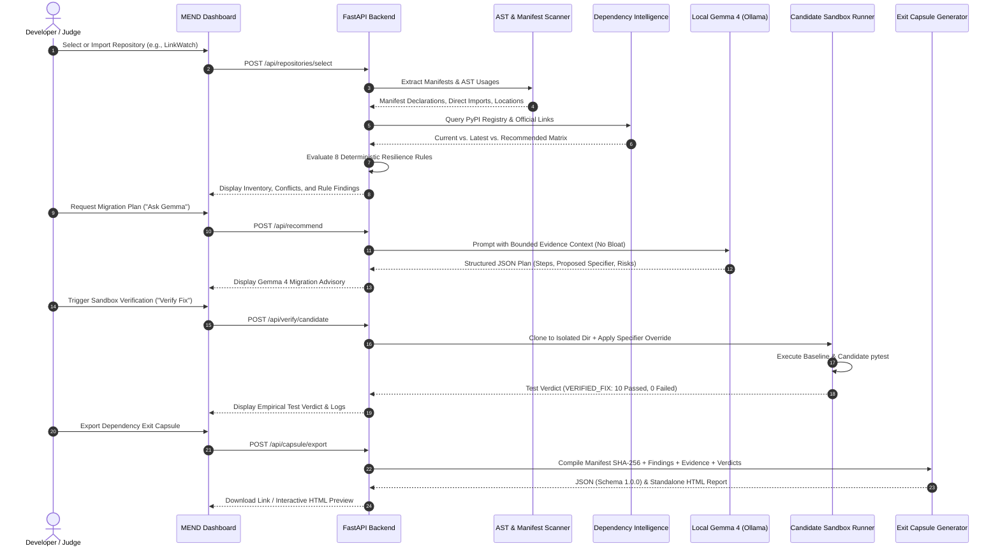

# MEND — Migration Evidence & Dependency Navigator
### Hacktoberfest 2026 — Track 1: Gemma 4 — Dependency Resilience

**Submission Repository**: [https://github.com/Themeta-verse/H26_RisingCoders_MEND](https://github.com/Themeta-verse/H26_RisingCoders_MEND)  
**Starter Baseline Benchmark**: [https://github.com/rishrek/LinkWatch](https://github.com/rishrek/LinkWatch)  
**Official Evaluation Target**: `LinkWatch` (CLI link/uptime monitor & HTML status dashboard)

[](#)
[](#)
[](#)
[-orange?style=flat-square)](#)
[](#)
[](mend/LICENSE)

---

## 1. Project Overview

### What MEND Stands For
**MEND** stands for **Migration Evidence & Dependency Navigator**.

### The Dependency Maintenance Problem
Software engineering teams face a recurring challenge: **dependency rot**. While security scanners notify teams of known CVE vulnerabilities, the vast majority of software breakages during regular development and deployment stem from **Dependency Friction & Transitive Incompatibilities**:
- Uncoordinated minor or major version bumps.
- Manifest drift between package management files (e.g., `pyproject.toml` declaring `>=2.0` while `requirements.txt` strictly pins `==1.10.13`).
- Silent breaking changes in transitive peer dependencies (e.g., an upgraded helper library removing an internal function imported by an unpinned dependency).
- Dead or abandoned upstream libraries that block language runtime upgrades.
- "Phantom" or zombie dependencies that remain declared in manifests despite having zero imports in the source code.

### Why Updating to the "Latest Version" Breaks Projects
A common mistake in dependency management is assuming that upgrading every package to its latest release is safe. Blindly updating a package (`pip install --upgrade <package>`) frequently causes catastrophic runtime failures because:
1. **API Removals & Renames**: Major releases frequently deprecate and remove legacy functions or classes (e.g., `MarkupSafe 3.0` removing `soft_unicode`, which broke `Jinja2 2.11.3`).
2. **Behavioral Shifts**: Upgrades can alter configuration syntax or defaults (e.g., Pydantic v1's `@validator` and `class Config` failing under Pydantic v2).
3. **Peer Dependency Incompatibilities**: Upgrading package $A$ might silently pull in a transitive dependency $C$ that is incompatible with package $B$.
4. **Runtime Python Compatibility**: A package's latest release may drop support for the project's Python version, or depend on C-extensions that fail compilation in certain environments.

### How MEND Solves This
MEND transforms dependency maintenance from stressful guesswork into a deterministic, evidence-driven, test-verified discipline:
1. **Investigate**: Statically parses dependency manifests and codebase ASTs to map declared requirements to actual source-level import usage.
2. **Evaluate**: Computes a side-by-side dependency intelligence matrix comparing current versions with official PyPI releases and evaluating 8 deterministic resilience rules.
3. **Recommend**: Prompts a local **Gemma 4** model (`gemma4:e2b-it-q4_K_M`) via Ollama with bounded evidence (manifest lines, AST code snippets, rule findings, and raw baseline tracebacks) to generate structured, risk-conscious migration guidance.
4. **Verify**: Empirically executes tests in an isolated, temporary candidate environment without modifying the target repository.
5. **Document**: Emits an auditable **Dependency Exit Capsule** (standardized JSON schema `1.0.0` and standalone zero-dependency HTML report) and maintains an anchored **Migration Integrity Ledger**.

### Target Users and Problem Statement
- **Target Users**: Software engineers, platform/DevOps engineers, security and compliance auditors, and open-source project maintainers.
- **Problem Statement**: Development teams need a safe, verifiable, and zero-cost mechanism to navigate dependency upgrades, resolve transitive incompatibilities, and audit dependency health without blind bumps, cloud data leaks, or unverified AI hallucinations.

---

## 2. The Core Idea

> ### **AI proposes. Evidence grounds. Tests verify.**

MEND is built on the strict principle that an AI model should never be trusted as the sole authority on dependency safety:
- **Gemma 4 provides AI-assisted reasoning**: It identifies potential replacement packages, outlines step-by-step migration procedures, drafts necessary code adaptations, and highlights residual architectural risks.
- **Deterministic scanning and package metadata provide grounding evidence**: Concrete AST import snippets, exact manifest lines, PyPI release metadata, and deterministic resilience rules provide factual context that constrains the AI.
- **Empirical test execution provides verification**: A migration candidate is only marked as a verified fix if actual test suite execution (`pytest`) demonstrates that baseline failures are resolved and no regressions were introduced.

**Under no circumstances does MEND claim that an LLM independently guarantees that a dependency is safe or compatible.**

---

## 3. Implemented Features & Capability Matrix

MEND maintains honest capability boundaries across ecosystems and workflows:

| Capability / Feature | Status | Description & Implementation Scope |
| :--- | :---: | :--- |
| **Manifest Discovery & Parsing** | **FULL** | Recursively detects and parses Python (`pyproject.toml`, `requirements*.txt`, `setup.py`) and JavaScript (`package.json`). |
| **AST Source Code Usage Analysis** | **FULL** | Uses Python's native `ast` module to record exact file paths, line numbers, and imported symbols for all dependencies. |
| **Deterministic Resilience Rules** | **FULL** | 8 built-in rules detecting transitive incompatibilities, manifest conflicts, abandoned libraries, deprecated APIs, and phantom packages. |
| **Dependency Intelligence Matrix** | **FULL** | Side-by-side comparison of current, latest stable (PyPI), and recommended versions with change severity and compatibility ratings. |
| **Official Documentation Links** | **FULL** | Clickable links to PyPI project pages, official release notes, documentation, changelogs, and source repositories. |
| **Gemma 4 Migration Advisory** | **FULL** | Local inference via Ollama (`gemma4:e2b-it-q4_K_M`) with bounded context and strict Pydantic JSON schema validation. |
| **Standard Library Fast-Path** | **FULL** | Instantly classifies built-in Python modules (e.g., `datetime`, `os`, `sys`) without invoking Ollama. |
| **Isolated Candidate Verification** | **FULL (Python)** | Executes `pytest` in isolated workspace clones with overridden `PYTHONPATH` without altering the target repository. |
| **JavaScript Candidate Sandbox** | **UNSUPPORTED** | *Explicit boundary*: Static manifest and import parsing are supported for JS, but dynamic sandbox verification is explicitly disclaimed. |
| **Baseline vs. Candidate Test Diffs** | **FULL** | Captures execution exit codes, passed/failed counts, durations, and failure tracebacks. |
| **Migration Integrity Ledger** | **FULL** | Lifecycle state machine (`OBSERVED → RECOMMENDED → EXECUTED → VERIFIED / FAILED / INCONCLUSIVE`) with SHA-256 digest per entry. |
| **Manifest Snapshot SHA-256** | **FULL** | Cryptographic fingerprint computed over sorted, normalized manifest declarations. |
| **Dependency Exit Capsule Export** | **FULL** | Emits machine-readable JSON (schema `1.0.0`) and standalone, self-contained HTML reports embedding full evidence and test logs. |
| **Reusable Multi-Repo Management** | **FULL** | Supports cloning and analyzing any public GitHub repository URL (`git clone --depth 1`) with workspace isolation. |
| **On-Demand Scan Drift Check** | **FULL** | Snapshot diff comparison identifying added/removed dependencies, specifier shifts, and AST usage changes between scans. |
| **Technical Dark / Light Theme** | **FULL** | Swiss-style editorial UI with dark charcoal surfaces, electric-blue accents, light mode toggle, live timers, and cancel buttons. |

---

## 4. System Architecture & Real Data Flow

### The Real Data Flow
```
Repository Under Test
       │
       ▼
Deterministic Scanner (AST & Manifests)
       │
       ▼
Dependency Intelligence Service (PyPI Metadata & Official Links)
       │
       ▼
Evidence Dossier (Bounded Context Assembly)
       │
       ▼
Local Gemma 4 Advisory (Ollama Bounded Prompting)
       │
       ▼
Candidate Verification Runner (Isolated Sandbox & pytest)
       │
       ▼
Migration Integrity Ledger (Lifecycle State Tracking)
       │
       ▼
Dependency Exit Capsule (JSON 1.0.0 & Standalone HTML)
```

### Component Responsibilities
1. **Repository Manager (`mend/core/repo_manager.py`)**:
   - Manages registered targets (the pristine `LinkWatch` benchmark and cloned public GitHub repositories).
   - Enforces workspace isolation (`mend/workspaces/<owner>__<repo>`) and tracks repository commit SHAs.
   - Strictly prohibits mutation or remote overwriting of the immutable `LinkWatch` baseline.
2. **Deterministic Scanner (`mend/core/scanner.py`)**:
   - Scans declared manifests (`requirements.txt`, `pyproject.toml`, `package.json`).
   - Normalizes package names according to PEP 503 standards.
   - Uses Python's native `ast` module to inspect source code imports without executing untrusted code.
   - Computes the canonical **Manifest Snapshot SHA-256**.
3. **Dependency Intelligence Service (`mend/core/version_service.py`)**:
   - Queries the official PyPI JSON API with strict timeouts and caching.
   - Formulates a side-by-side matrix comparing declared, installed, and latest stable versions.
   - Provides verified clickable links to PyPI, official releases, documentation, and changelogs.
   - Falls back to embedded offline baselines if the network or registry is unreachable.
4. **Resilience Rule Engine (`mend/core/rules.py`)**:
   - Evaluates 8 deterministic static rules across transitive incompatibilities, manifest conflicts, deprecated packages, and unused dependencies.
5. **Gemma 4 Model Client (`mend/core/model_client.py`)**:
   - Communicates exclusively with local Ollama (`http://localhost:11434/api/chat`).
   - Packages bounded evidence (never dumps whole repositories).
   - Validates response JSON against strict Pydantic schemas, with error recovery and stdlib bypass.
6. **Candidate Verification Runner (`mend/core/candidate_runner.py`)**:
   - Executes baseline tests against the target virtual environment in read-only mode.
   - Prepares an isolated candidate sandbox directory for proposed upgrades (`pip install --target`).
   - Executes candidate tests using prioritized `PYTHONPATH` overrides under resource limits (60s timeout, 250KB output cap).
   - Evaluates test outcomes to assign empirical verdicts.
7. **Migration Integrity Ledger (`mend/core/ledger.py`)**:
   - Tracks each dependency across its lifecycle: `OBSERVED → RECOMMENDED → EXECUTED → VERIFIED / FAILED / INCONCLUSIVE`.
   - Anchors evidence to repository identity and Git commit SHA.
8. **Dependency Exit Capsule Generator (`mend/core/capsule.py`)**:
   - Packages complete audit records into machine-readable JSON (schema `1.0.0`) and standalone zero-dependency HTML.

### Mermaid Architecture Diagram



### Mermaid Workflow Sequence Diagram



---

## 5. Technology Stack & Rationale

| Technology | Role in MEND | Architectural Rationale |
| :--- | :--- | :--- |
| **Python 3.12** | Core Backend Logic | Native `ast` module for safe static analysis, subprocess control for sandboxed execution, and rich packaging ecosystem. |
| **FastAPI** | REST API & Static Server | High-performance asynchronous HTTP framework with automatic OpenAPI documentation and static asset mounting. |
| **React 18** | User Interface | Component-based state management for real-time inventory filtering, diff inspection, and live verification logs. |
| **TypeScript** | Frontend Safety | Strict typing prevents frontend runtime exceptions when handling complex nested manifest and ledger payloads. |
| **Vite** | Frontend Tooling | Extremely fast development server and optimized single-bundle production compilation. |
| **Ollama** | Local Model Runtime | Manages quantized model weights, GPU/CPU acceleration, and local HTTP REST inference (`localhost:11434`). |
| **Gemma 4** (`gemma4:e2b-it-q4_K_M`) | AI Migration Advisory | Google's open-weight model tuned for instruction following and systems reasoning, running 100% locally and cost-free. |
| **PyPI JSON API** | Metadata Registry | Authoritative source for current releases, upload dates, documentation URLs, and changelog locations. |
| **pytest** | Test Framework | Executes baseline and candidate test suites; provides detailed failure tracebacks and assertion introspection. |
| **SHA-256** | Tamper-Evident Hashing | Computes cryptographic digests for normalized manifest snapshots, ledger entries, and exported capsule files. |

> **Active Model Provider Disclosure**: MEND's application runtime exclusively connects to local Ollama. It does not use or connect to OpenAI, Claude, Llama, Gemini API, or any paid cloud model provider.

---

## 6. AI and Model Terminology Explained

To maintain technical clarity for judges and developers, MEND uses precise industry terminology:

- **AI (Artificial Intelligence)**: The broad engineering discipline of developing computational systems capable of performing complex pattern-matching, synthesis, and reasoning tasks.
- **LLM (Large Language Model)**: A specialized neural network trained on extensive code and natural language text to interpret context and generate coherent, structured output.
- **Gemma**: Google's family of lightweight, state-of-the-art open-weight models built from the same research and technology as Gemini. MEND uses Gemma 4 for migration reasoning.
- **Llama**: Meta's separate open-weight model family. MEND does not use Llama; its inference is exclusively Gemma 4.
- **Ollama**: The local runtime software that serves quantized open-weight models through a simple HTTP API on your local machine (`http://localhost:11434`).
- **Local Inference**: The entire model computation runs on the user's hardware CPU or GPU. Prompts and source code never leave your machine, require zero paid API tokens, and function without an internet connection.

### The Configured Model Tag: `gemma4:e2b-it-q4_K_M`
MEND is configured to use the exact model tag:
```
gemma4:e2b-it-q4_K_M
```
- **`gemma4`**: Specifies the Gemma 4 architecture.
- **`e2b`**: Identifies the 4.6-billion parameter efficient model variant.
- **`it`**: Designates the instruction-tuned variant, optimized for following structured task instructions.
- **`q4_K_M`**: Represents 4-bit Medium K-quantization, providing optimal trade-offs between memory footprint (~3.2 GB RAM), inference speed, and reasoning fidelity on standard developer laptops.

### Separation of Application Model vs. Coding Assistants
- **Application Model**: The model configured within MEND's backend (`mend/core/model_client.py`) that generates migration plans during application execution is **`gemma4:e2b-it-q4_K_M`**.
- **Coding Assistant**: Coding assistants used during project development are distinct development tools and should not be confused with the application's runtime inference engine.

---

## 7. Real Dependency Intelligence Workflow

MEND does not perform superficial version checks. It executes a comprehensive, 7-step intelligence pipeline:

```
1. Discover & Parse Manifests (pyproject.toml, requirements.txt, package.json)
2. Extract AST Direct Imports (Map imported symbols to file paths and line numbers)
3. Retrieve Package Metadata (Live PyPI JSON queries with timeout & local cache)
4. Compare Current vs. Latest (Evaluate semver difference: major, minor, patch)
5. Synthesize Migration Target (Account for peer constraints, not just highest version)
6. Present Official Evidence Links (PyPI, Release Notes, Docs, Changelogs, Source)
7. Graceful Offline Fallback (Air-gapped operation using built-in cached baselines)
```

### Why Latest Stable is Not Automatically the Recommended Target
A naive dependency tool recommends the highest version number available. MEND distinguishes between **Latest Stable** and **Recommended Target**:
- For `Jinja2`, the latest version on PyPI is `3.1.6`, but MEND recommends `>=3.1.4` because version `3.1.4` is the minimal compatible release that resolves the `MarkupSafe 3.x` import error while minimizing breaking template changes.
- For `pydantic`, `pyproject.toml` requests `>=2` while `requirements.txt` pins `==1.10.13`. Recommending Pydantic v2 requires code-level migration because `linkwatch/config.py` uses deprecated v1 `@validator` decorators.

### Ecosystem Limitations & Honesty
- **Python**: **Full Support**. AST parsing, PEP 508 manifest normalization, 8 deterministic rules, PyPI live intelligence, and isolated `pytest` candidate verification.
- **JavaScript / Node.js**: **Partial Static Support**. Parses `package.json` and scans `import`/`require` syntax for unpinned ranges and deprecated packages. Dynamic sandbox verification is explicitly unsupported and disclaimed in both the UI and exported Capsules.

---

## 8. Candidate Verification & Sandbox Runner

When a developer requests empirical proof of a migration, MEND executes an isolated candidate verification:

```
Step 1: Record Pristine Baseline
        Runs pytest in the target repository's existing virtual environment in read-only mode.
        Captures baseline pass/fail counts, exit code, and failure tracebacks.
                                │
                                ▼
Step 2: Create Isolated Candidate Workspace
        Clones repository files to a temporary sandbox directory (e.g., mend/sandbox_runs/cand_...).
        The original repository and its .venv remain untouched and immutable.
                                │
                                ▼
Step 3: Apply Candidate Override
        Installs the proposed dependency version into a localized candidate target folder
        using direct parameter invocation (pip install --target ...).
                                │
                                ▼
Step 4: Execute Candidate Tests
        Runs pytest with PYTHONPATH prioritizing candidate packages over the baseline.
        Enforces a 60-second execution timeout and a 250KB stdout/stderr buffer cap.
                                │
                                ▼
Step 5: Compare Outcomes & Assign Verdict
        Computes the delta between baseline and candidate results to assign an empirical verdict.
```

### Implemented Verdict Semantics
MEND uses strict, deterministic verdict categories:
- **`VERIFIED_FIX`**: The candidate resolved all baseline test failures with zero regressions (e.g., LinkWatch moving from 9 Passed, 1 Failed to 10 Passed, 0 Failed).
- **`STILL_FAILING`**: The candidate did not resolve the baseline failure; the same or similar failures persist.
- **`REGRESSION`**: The candidate introduced new test failures that were not present in the baseline run.
- **`INCONCLUSIVE`**: The test suite produced ambiguous output or failed to collect tests.
- **`BLOCKED`**: The candidate package could not be installed (e.g., compilation error, network failure, or invalid specifier).
- **`NOT_RUN`**: Verification was not attempted.

### Strict Epistemic Bounds & Sandbox Notice
- **Zero Tests Collected != Verified Fix**: If a test command collects zero tests, MEND marks the result as inconclusive rather than a verified fix.
- **AI Recommendation != Verified Fix**: An advisory from Gemma 4 remains an advisory until empirical pytest execution succeeds.
- **Inconclusive Remains Inconclusive**: If a test run exits abnormally, MEND does not assume success.
- **Sandbox Boundary Notice**: The sandbox isolates file modifications and environment overrides via workspace directory copies and `PYTHONPATH` overrides. It operates under current host-user permissions and is not a kernel-level container or VM.

---

## 9. Integrity Ledger & Dependency Exit Capsule

### Manifest Snapshot SHA-256
To ensure reproducibility and tamper-evidence across CI/CD pipelines, MEND computes the **Manifest Snapshot SHA-256**:
- **Included Declarations**: All declared dependency manifests (`requirements.txt`, `requirements-dev.txt`, `pyproject.toml`, `package.json`).
- **Normalization Rules**: Package names are normalized to lowercase alphanumeric with single hyphens (PEP 503), version specifiers are standardized, comments and whitespace are stripped, and entries are sorted lexicographically.
- **What It Detects**: Any addition, removal, or modification of declared dependencies or version constraints immediately alters the digest.
- **What It Does Not Cover**: The Manifest Snapshot SHA-256 is not a hash of the entire binary source tree or git history. It specifically fingerprints declared dependency inputs.

### Migration Integrity Ledger
The ledger anchors each dependency across strict lifecycle transitions:
```
OBSERVED ──▶ RECOMMENDED ──▶ EXECUTED ──▶ VERIFIED / FAILED / INCONCLUSIVE
```
Every ledger entry computes an individual SHA-256 digest binding:
`{repo_id, commit_hash, package_name, observed_facts, recommendation_data, candidate_data, stage}`

### Dependency Exit Capsule Formats
Exported capsules capture the full provenance of dependency decisions:
1. **Machine-Readable JSON (`$schema_version: "1.0.0"`)**: Contains complete metadata, raw scan inventories, AST usage locations, rule findings, side-by-side intelligence, Gemma 4 advisories, baseline test logs, candidate execution logs, and embedded SHA-256 hashes.
2. **Standalone Zero-Dependency HTML**: An executive report complete with interactive filtering, expandable test logs, and side-by-side intelligence tables that renders entirely offline without external CDN dependencies.

---

## 10. Reusable Multi-Repository Workflow

MEND is not a hardcoded single-repo demonstration. It includes a complete repository management engine:

- **Immutable Benchmark**: The official `LinkWatch` challenge repository is permanently protected against mutation or remote git overwriting.
- **Public GitHub Import**: Enter any public GitHub repository URL (e.g., `https://github.com/bottlepy/bottle`). MEND performs a shallow clone (`--depth 1`) into `mend/workspaces/<owner>__<repo>`.
- **Zero-Code-Execution Inspection**: Newly imported repositories are scanned purely via static AST and manifest parsing. Untrusted code is never executed during inspection.
- **Repository Isolation**: All scan caches, rule findings, Gemma 4 advisories, sandbox test runs, and exported capsules are strictly isolated by repository identity and commit SHA.

### Operation Semantics: Add vs. Sync vs. Re-scan vs. Drift Check
- **Add Repository** (`POST /api/repositories/add`): Clones a public repository and registers its initial commit SHA.
- **Sync with GitHub** (`POST /api/repositories/sync`): Performs a remote network fetch (`git fetch --depth 1 origin`) on cloned public repositories. Explicitly disabled on the immutable LinkWatch benchmark.
- **Re-scan** (`POST /api/repositories/refresh`): Strictly local operation. Re-evaluates ASTs and manifests on current local disk files without network calls.
- **Drift Check** (`GET /api/scan/diff?refresh=true`): Computes an in-memory snapshot diff comparing the previous scan with the current scan to detect added/removed packages, specifier shifts, and AST count changes.

---

## 11. Key Findings on Target Codebase (`LinkWatch`)

When evaluating the official `LinkWatch` baseline repository, MEND discovered:

1. **Critical Incompatible Transitive Pairing**:
   - `requirements.txt:4` pins `Jinja2==2.11.3`.
   - The runtime environment has `MarkupSafe 3.0.4`.
   - `Jinja2 2.11.3` imports `from markupsafe import soft_unicode`.
   - `MarkupSafe 3.0+` completely removed `soft_unicode`.
   - **Observed Test Failure**: `tests/test_report.py` crashes with `ImportError: cannot import name 'soft_unicode' from 'markupsafe'` (**Baseline: 9 Passed, 1 Failed**).
2. **Manifest Specification Conflict**:
   - `pydantic` is declared with `==1.10.13` in `requirements.txt:5` but `>=2` in `pyproject.toml:17`.
   - Both the UI and generated Capsules reconcile this as the single true manifest conflict.
3. **Pydantic V1/V2 Code Collision**:
   - `linkwatch/config.py` uses deprecated v1 patterns (`@validator`, `class Config: anystr_strip_whitespace = True`), which break under Pydantic v2.
4. **Abandoned Upstream Library**:
   - `appdirs==1.4.4` (discontinued since 2017) used in `linkwatch/cache.py:4`; standard replacement is `platformdirs`.
5. **Deprecated Runtime API**:
   - `linkwatch/resources.py:1` imports `pkg_resources`, generating setuptools deprecation warnings.
6. **Obsolete Dev Framework**:
   - `nose==1.3.7` declared in `requirements-dev.txt:2` relies on `imp` (removed in Python 3.12); the test suite actually uses `pytest`.
7. **Unused / Phantom Dependency**:
   - `six` declared in manifests, but 0 imports exist across the codebase.
8. **Empirically Verified Sandbox Fix**:
   - Upgrading `Jinja2` to `>=3.1.4` was tested in an isolated sandbox, turning the baseline into **10 Passed, 0 Failed** (`VERIFIED_FIX`).

---

## 12. Installation and Local Setup

### Prerequisites
- **Python**: Version 3.12+ (tested with Python 3.12.10).
- **Node.js**: Version 18+ (tested with Node.js v24.19).
- **Git**: Installed and available on system PATH.
- **Ollama**: Installed and running locally.

### Step 1: Set Up Python Virtual Environment
Open Windows PowerShell or a standard bash shell in the repository root:

```powershell
# Windows PowerShell
python -m venv mend/.venv
.\mend\.venv\Scripts\Activate.ps1
pip install -r mend/requirements.txt
```

```bash
# Linux / macOS / Bash
python -m venv mend/.venv
source mend/.venv/bin/activate
pip install -r mend/requirements.txt
```

> **Note on LinkWatch Dependencies**: Do not install LinkWatch's root requirements into MEND's virtual environment. MEND operates as an external auditor and candidate verifier.

### Step 2: Ensure Ollama is Running & Pull Gemma 4
Verify Ollama is running and pull the exact configured model tag:

```bash
# Pull the configured Gemma 4 model variant
ollama pull gemma4:e2b-it-q4_K_M

# Verify the model is present
ollama list
```

### Step 3: Build the Frontend (Pre-built in Repository)
The production bundle is already compiled in `mend/frontend/dist/`. To rebuild manually:

```bash
cd mend/frontend
npm install
npm run build
cd ../..
```

### Step 4: Launch MEND Backend & Dashboard
Start the FastAPI server (which automatically serves the compiled React dashboard at `/`):

```bash
# Windows PowerShell
.\mend\.venv\Scripts\python -m uvicorn mend.api.main:app --host 127.0.0.1 --port 8000

# Linux / macOS / Bash
./mend/.venv/bin/python -m uvicorn mend.api.main:app --host 127.0.0.1 --port 8000
```

Open your web browser and navigate to:
**`http://127.0.0.1:8000`**

### Step 5: Run MEND Automated Tests
Run MEND's complete 33-test verification suite:

```powershell
# Windows PowerShell
$env:PYTHONPATH='.'
.\mend\.venv\Scripts\python -m pytest mend/tests -v
```

```bash
# Linux / macOS / Bash
PYTHONPATH=. ./mend/.venv/bin/python -m pytest mend/tests -v
```

All 33 tests execute and pass:
- `test_adapters.py`: Python full detection, JavaScript partial detection & rules, and unsupported ecosystem fallback (3 tests).
- `test_api.py`: Repository management, status checks, scans, rule evaluations, capsule exports, ledger anchoring, and PyPI intelligence (21 tests).
- `test_capsule.py`: Schema 1.0.0 validation, SHA-256 embedding, and section completeness (1 test).
- `test_model_client.py`: Structured JSON parsing, error handling, and stdlib fast-path (4 tests).
- `test_rules.py`: Detections of all 8 deterministic resilience rules (1 test).
- `test_scanner.py`: AST parsing, manifest conflict detection, name normalization, and datetime deduplication (3 tests).

---

## 13. Troubleshooting Guide

| Issue | Likely Cause | Recommended Action |
| :--- | :--- | :--- |
| **Ollama is not running** | The Ollama background service has not been started. | Open a terminal and run `ollama serve`. In PowerShell, verify with `Invoke-RestMethod http://localhost:11434/api/tags`. |
| **Required model tag missing** | Ollama is running but `gemma4:e2b-it-q4_K_M` has not been downloaded. | Run `ollama pull gemma4:e2b-it-q4_K_M` and verify with `ollama list`. |
| **Model request times out** | Hardware CPU/GPU is under heavy load or cold-loading weights. | The UI provides a live elapsed timer and a **Cancel Request** button. Default timeout is 45s; retry when system resources stabilize. |
| **Package registry unreachable** | Air-gapped network or PyPI connection timeout. | MEND automatically switches to embedded offline baselines for key packages (`Jinja2`, `pydantic`, `appdirs`, `markupsafe`, `six`). |
| **Dependency metadata incomplete** | Private or proprietary internal package not indexed on PyPI. | MEND marks the release as `unknown` and falls back to AST code usage and manifest evidence without crashing. |
| **Repository cloning fails** | Invalid repository URL, private repository requiring credentials, or missing Git. | Verify `git` is on PATH. Ensure the URL is public and formatted as `https://github.com/<owner>/<repo>`. |
| **Candidate suite collects zero tests** | Target repository does not use pytest or has tests in non-standard paths. | MEND assigns verdict `INCONCLUSIVE` and logs the runner output. Zero tests collected is never marked as a verified fix. |
| **Candidate tests fail** | The proposed upgrade introduced breaking changes or failed dependencies. | MEND assigns verdict `STILL_FAILING` or `REGRESSION` and records full stderr tracebacks in the ledger and Capsule. |
| **Frontend build fails** | Node.js version mismatch or missing dependencies in `mend/frontend`. | Ensure Node.js 18+ is installed. Run `npm clean-install` inside `mend/frontend/`. |
| **Backend fails to start** | Port 8000 is occupied by another process. | Launch on an alternative port: `python -m uvicorn mend.api.main:app --host 127.0.0.1 --port 8080`. |
| **Exit Capsule export fails** | Target repository has not been scanned yet. | Navigate to the inventory tab or trigger a scan via `POST /api/scan` before exporting capsules. |

---

## 14. Repository Structure & Verification Artifacts

```
.
├── linkwatch/                            # Pristine target codebase under test (read-only)
├── tests/                                # Pristine target pytest suite (baseline: 9P, 1F)
├── pyproject.toml                        # Target pyproject manifest (declares pydantic>=2)
├── requirements.txt                      # Target requirements manifest (pins pydantic==1.10.13, Jinja2==2.11.3)
├── requirements-dev.txt                  # Target development requirements (pins nose==1.3.7)
├── sites.toml                            # Target configuration file
├── MEND_PROJECT_RULES.md                 # Operational rules and epistemic boundaries
├── PRESENTATION_SLIDES_EVIDENCE.md       # Verbatim slide evidence for Hacktoberfest presentation
├── README.md                             # This root documentation
└── mend/                                 # MEND Application Engine
    ├── api/
    │   ├── __init__.py
    │   └── main.py                       # FastAPI REST endpoints & static file mounting
    ├── core/
    │   ├── __init__.py
    │   ├── adapters.py                   # Ecosystem adapters (Python Full, JS Partial, Other)
    │   ├── candidate_runner.py           # Isolated candidate runner & sandbox execution
    │   ├── capsule.py                    # Dependency Exit Capsule generator (JSON 1.0.0 / HTML)
    │   ├── ledger.py                     # Migration Integrity Lifecycle Ledger (SHA-256 state tracking)
    │   ├── model_client.py               # Local Gemma 4 client via Ollama (:11434)
    │   ├── repo_manager.py               # Multi-repo manager (LinkWatch & public GitHub clones)
    │   ├── rules.py                      # 8 Deterministic resilience rules
    │   ├── scanner.py                    # Deterministic AST & manifest parser (Manifest SHA-256)
    │   └── version_service.py            # Side-by-side PyPI intelligence & official links
    ├── exports/                          # Generated auditable Dependency Exit Capsules
    │   ├── dependency_exit_capsule_linkwatch.json  # Machine-readable JSON
    │   └── dependency_exit_capsule_linkwatch.html  # Standalone zero-dependency HTML
    ├── frontend/                         # React + TypeScript + Vite Dashboard
    │   ├── dist/                         # Compiled production assets
    │   ├── src/                          # UI components and state management
    │   ├── package.json
    │   ├── vite.config.ts
    │   └── README.md                     # Frontend architecture documentation
    ├── tests/                            # Automated test suite (33/33 passing)
    ├── README.md                         # MEND Engine documentation
    └── requirements.txt                  # MEND backend dependencies (fastapi, uvicorn, httpx, etc.)
```

---

## 15. License & Governance

- **MEND Application**: Open-source under the [MIT License](mend/LICENSE).
- **Gemma 4 Model Weights**: Governed by the [Gemma Terms of Use](https://ai.google.dev/gemma/terms).
- **Target Repository (`LinkWatch`)**: Preserved as a read-only benchmark subject under its original open-source license.
